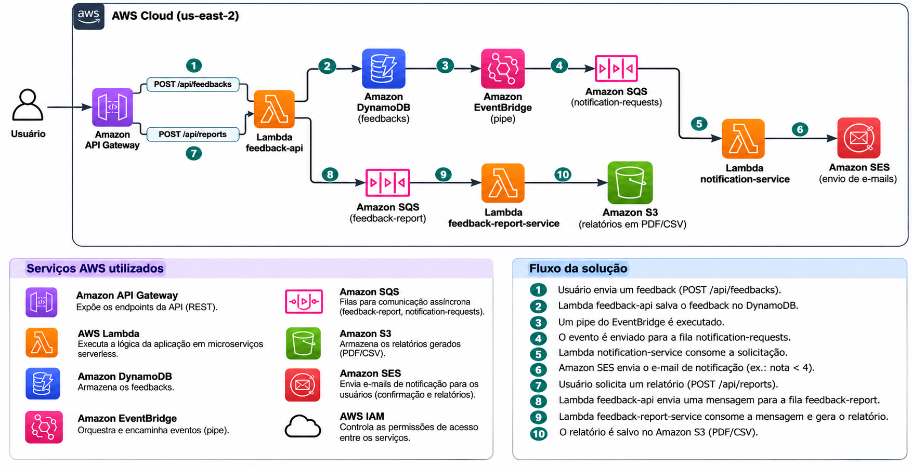
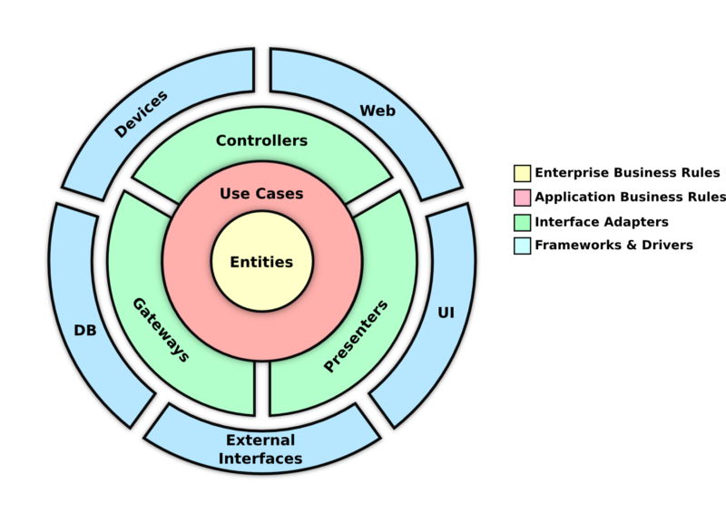

# Feedback Report Service

Microsserviço worker responsável por consumir eventos de geração de relatório semanal, buscar feedbacks no DynamoDB e publicar um CSV consolidado no S3.

## Descrição do projeto

> Para garantir a qualidade dos cursos on-line, é essencial que os
> estudantes possam fornecer feedbacks e que os administradores possam
> acompanhar rapidamente a satisfação dos alunos. O sistema deverá ser capaz
> de receber feedbacks, enviar notificações para itens críticos e gerar relatórios
> periódicos para auxiliar na análise dos dados.

## Stack

- Java 21
- Quarkus 3.40.x
- AWS Lambda (handler Java)
- Amazon SQS (trigger)
- Amazon DynamoDB (origem dos feedbacks)
- Amazon S3 (destino do CSV)
- Maven + JUnit 5 + Mockito

## Arquitetura da solução



## Arquitetura limpa



## Contrato do evento de entrada (SQS body)

```json
{
  "date": "2026-11-20",
  "periodWeek": "2026-W47"
}
```

## Fluxo de processamento

1. O Lambda recebe uma mensagem da fila `feedbacks-report`.
2. O handler desserializa o evento (`date` e `periodWeek`).
3. O caso de uso consulta os feedbacks no DynamoDB pelo `periodWeek`.
4. O serviço gera o CSV contendo:
   - descrição
   - urgência
   - data de envio
   - quantidade de avaliações por dia
   - quantidade de avaliações por urgência
5. O arquivo é salvo no S3 com chave no formato:
   `reports/periodWeek=<periodWeek>/feedback-report-<date>.csv`

## Comandos básicos

### Compilar

```bash
./mvnw clean compile
```

### Executar testes

```bash
./mvnw clean test
```

### Gerar pacote JVM

```bash
./mvnw clean package -DskipTests
```

### Build nativo para Lambda

```bash
./mvnw clean package -Plambda -Dquarkus.native.enabled=true -Dquarkus.native.container-build=true
```

## Configuração

Arquivo principal: `src/main/resources/application.properties`

```properties
# AWS
quarkus.dynamodb.aws.region=${AWS_REGION:us-east-2}
quarkus.dynamodb.aws.credentials.type=default
quarkus.s3.aws.region=${AWS_REGION:us-east-2}
quarkus.s3.aws.credentials.type=default
quarkus.sqs.aws.region=${AWS_REGION:us-east-2}
quarkus.sqs.aws.credentials.type=default

# Feedback Report Lambda
quarkus.lambda.handler=sqsFeedbackReportHandler
feedback.table.name=${FEEDBACK_TABLE_NAME:feedbacks}
feedback.table.period-week-index-name=${FEEDBACK_TABLE_PERIOD_WEEK_INDEX_NAME:periodWeek-createdAt-gsi}
feedback.report.bucket.name=${FEEDBACK_REPORT_BUCKET_NAME:feedback-report}
feedback.report.queue.name=${FEEDBACK_REPORT_QUEUE_NAME:feedbacks-report}
```

Para desenvolvimento local, usar `application-local.properties` com LocalStack.

## CI/CD

Pipeline de deploy para ECR: `.github/workflows/deploy-ecr.yml`

Fluxo:
1. build nativo
2. build/push da imagem para ECR
3. update da função Lambda com a nova imagem

## Estrutura resumida

- `src/main/java/com/report/domain` - entidades de domínio e portas
- `src/main/java/com/report/application` - DTOs e caso de uso
- `src/main/java/com/report/infrastructure` - integração AWS
- `src/main/resources/application.properties` - configuração padrão
- `src/main/resources/application-local.properties` - configuração local
